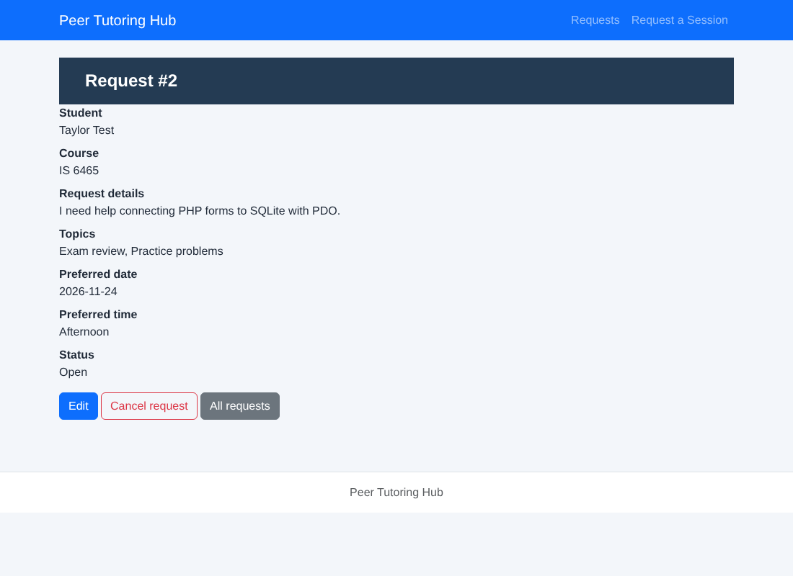

# Lab 6 Notes: PHP, PDO, and SQLite Integration

Cody Osmond, IS 6465

The project root contains the full `peer-tutoring` starter: `config/`, `css/`, `database/`, `includes/`, `php/`, `repositories/`, `services/`, `tests/`, and `index.php`. I did not change any of the provided application or test files. The screenshots are in the `screenshots/` folder.

## Part 1: Set Up the Database

From the project root, I created the database from the setup script and then listed its tables:

```text
$ sqlite3 database/tutoring.db < database/setup-database.sql
$ sqlite3 database/tutoring.db
sqlite> .tables
students           tutoring_requests
sqlite> .quit
```

Both tables, `students` and `tutoring_requests`, appeared. The setup script also inserts one sample student (Maria Lopez) and one sample request, which became request #1.

## Part 2: Run the Application

I started the PHP development server from the project root with `php -S 0.0.0.0:8000` and opened port 8000.

**URL opened:** `http://127.0.0.1:8000/` (in Codespaces, this is the forwarded port 8000 address, `https://<codespace-name>-8000.app.github.dev/`). The root URL redirected to `/php/request-form.php`, the tutoring request form.

I submitted one valid request with test data: student **Taylor Test** (`taylor.test@example.edu`), course IS 6465, preferred date 2026-11-24, the reason "I need help connecting PHP forms to SQLite with PDO.", the topics Exam review and Practice problems, and the preferred time Afternoon.

The request was saved and displayed. After I clicked **Request session**, the application redirected to `php/request-details.php?request_id=2`, which showed Request #2 with all of my values and a status of Open.

**Request detail page:**



## Part 3: Test the Application Workflows

For the filter test, I submitted a second request in a different course: **Sam Sample** (`sam.sample@example.edu`), IS 6495, 2026-11-30, Study plan, Morning. It became request #3.

| Test | What I Did | Expected Result | Actual Result | Pass or Fail |
|---|---|---|---|---|
| Submit a valid request | Submitted Taylor Test's IS 6465 request (Afternoon, Exam review and Practice problems) from the request form. | A new tutoring request is created with status Open. | The page redirected to Request #2, which showed every value I entered and the status Open. | Pass |
| View all requests | Opened **Requests** (`php/requests.php`) with no filters. | The new request appears in the request list. | The list showed requests #3 (Sam Sample), #2 (Taylor Test), and #1 (Maria Lopez, the seed record), newest first. | Pass |
| Filter requests | Filtered by course IS 6495; then by course IS 6465 and status Open; then by course IS 6570; and, after the cancel test, by status Cancelled. | Filtering by course or status shows matching requests. | IS 6495 showed only #3. IS 6465 + Open showed #2 and #1. IS 6570 showed "No matching requests." Cancelled showed only #2. | Pass |
| Edit an Open request | On Request #2, clicked **Edit**, changed the reason to "I need help with PDO prepared statements and form validation.", the date to 2026-11-25, and the time to Evening, added Study plan, and clicked **Save changes**. | The revised values are displayed. | The page returned to Request #2 and showed the new reason, all three topics, 2026-11-25, and Evening. The status stayed Open. | Pass |
| Cancel an Open request | On Request #2, clicked **Cancel request**. The confirmation page said "Cancel request #2? The record will be retained with status Cancelled." I clicked **Yes, cancel request**. | The request status changes to Cancelled. | Request #2 showed the status Cancelled, and the Edit and Cancel request buttons were gone. The row was kept, not deleted. | Pass |
| Try to edit or cancel a cancelled request | Opened `edit-request.php?request_id=2` and `delete-request.php?request_id=2` directly. I also sent POST requests straight to `update-request.php` and `delete-request.php` for request #2, which skips the pages' checks. | The application does not allow the change. | The edit page showed "Only Open requests may be edited." and the cancel page showed "Only Open requests can be cancelled." with no confirm button. Both direct POST requests returned HTTP 409 with "Request not found or not Open," and the record did not change. | Pass |
| Submit an invalid request (extra test) | Submitted the form with the reason "short" (5 characters). | The request is rejected and nothing is saved. | The server returned HTTP 422 with the heading "Request could not be submitted" and the message "Describe your request using 10 to 500 characters." The request list still had only three requests, so nothing was saved. | Pass |

The block on cancelled requests is enforced in two places. The pages hide the buttons, and the SQL itself only changes rows `WHERE request_id = ? AND status = 'Open'` (`repositories/requestPDO.php`, lines 18 and 22). That second check is why the direct POST requests failed too.

Screenshots: [request form](screenshots/01-request-form.png), [request list](screenshots/03-request-list.png), [course and status filter](screenshots/04-filter-course-status.png), [edit page](screenshots/05-edit-request.png), [cancelled request](screenshots/06-cancelled-detail.png), and [blocked edit](screenshots/07-edit-cancelled-blocked.png).

## Part 4: Trace the Request Submission Workflow

**Which file displays the tutoring request form?**
`php/request-form.php` displays the form. It includes the shared header and navigation and posts the form to `process-request.php` with the POST method.

**Which file receives the submitted form data?**
`php/process-request.php` receives the data. It rejects anything that is not a POST (HTTP 405) or that is missing the hidden `form_name` value (HTTP 400), then passes `$_POST` to `submitRequest()`. On success, it redirects to `request-details.php` with the new request ID; on a validation error, it returns HTTP 422 with the messages.

**Which file opens the PDO connection to SQLite?**
`config/db.php` opens it in the `openDatabase()` function. It connects with `new PDO('sqlite:' . $path)` to `database/tutoring.db`, sets PDO to throw exceptions on errors, returns rows as associative arrays, and runs `PRAGMA foreign_keys = ON`.

**Which file coordinates validation and the database transaction?**
`services/requestService.php` does. Its `submitRequest()` function calls `validateSubmission()`, which uses the Lab 4 rules in `includes/validation.php` plus checks for the name, email, course, and date. It then runs `beginTransaction()`, saves the student and the request, and calls `commit()`, or `rollBack()` if anything fails.

**Which files contain the SQL statements?**
The application's SQL is in the two repository files. `repositories/studentPDO.php` holds the student queries (`SELECT ... WHERE student_email = ?` and `INSERT OR IGNORE INTO students`). `repositories/requestPDO.php` holds the request queries (`INSERT`, the `SELECT ... JOIN` statements for one request and for the filtered list, and the two `UPDATE` statements for editing and cancelling). The `CREATE TABLE` statements and the seed data are in `database/setup-database.sql`.

**Which table stores student information?**
The `students` table stores it: `student_id`, `student_name`, and `student_email`. The email is `UNIQUE`.

**Which table stores tutoring requests?**
The `tutoring_requests` table stores them: `request_id`, `student_id`, `course`, `topic`, `preferred_date`, `preferred_time`, `status`, and `created_at`. The form's reason and checkbox topics are saved together as JSON in the `topic` column, because the Week 6 table has only one topic column.

**How does a tutoring request connect to the student who submitted it?**
Through the `student_id` foreign key. In `submitRequest()`, the service first inserts the student if the email is new (`INSERT OR IGNORE`), then looks the student up by email to get the `student_id`, and stores that ID in the new `tutoring_requests` row. `FOREIGN KEY (student_id) REFERENCES students(student_id)` ensures the ID belongs to a real student. A returning student is reused, so one student row can have many requests.

**Flow:**

```text
Browser form (php/request-form.php)
→ php/process-request.php            receives the POST, checks form_name
→ services/requestService.php        validates, starts and commits the transaction
→ repositories/studentPDO.php        finds or inserts the student
  repositories/requestPDO.php        inserts the request
→ SQLite database (database/tutoring.db, opened by config/db.php)
→ redirect to php/request-details.php?request_id=<new id>
```

**Why SQL statements belong in repository files rather than directly in the form page:**
Keeping SQL in repository files gives each layer one job: the page displays HTML, the service applies the business rules, and the repository talks to the database. When a query changes, there is one place to fix it, and every page that needs it, such as `request-details.php` and `edit-request.php`, both using `findRequest()`, reuses the same tested function. It also keeps every query in prepared statements with `?` placeholders in one place, which makes SQL injection easier to prevent and review. Finally, it lets `tests/integration-tests.php` test the service and repository functions directly against an in-memory database without loading a web page.

## Part 5: Run the Integration Tests

**Complete output of `php tests/integration-tests.php`:**

```text
PASS UC01 create and Open
PASS Lab 4 checkbox values preserved
FAIL Duplicate email reuses student
FAIL UC02 course and status filter
PASS Invalid reason rejected
FAIL Invalid submission writes nothing
PASS Edit Open request
PASS Updated reason persisted
PASS Cancel Open request
PASS Cancelled row retained
PASS Second cancellation rejected
PASS Unrelated request unchanged
PASS FK enforced
PASS UC02 empty filter result
FAILURES: 3
```

The starter's tests did not end with "All integration checks passed." Eleven checks passed and three failed, so I traced the cause.

**Why three checks fail:** the test builds a fresh in-memory database by running `database/setup-database.sql` (line 4 of the test). That script also inserts the seed student Maria Lopez and her IS 6465 request, which is Open. The three failing checks count rows as if the database started empty:

- **Duplicate email reuses student** expects 1 student, but the seed student makes the count 2.
- **UC02 course and status filter** expects 2 Open IS 6465 requests, but the seed request makes it 3.
- **Invalid submission writes nothing** expects 2 requests, but the seed request makes it 3.

The application code is not at fault: each failure is off by exactly the one seed row. To confirm this, I ran a copy of the test file with one added line after line 4 that empties the tables before the tests begin:

```php
$pdo->exec('DELETE FROM tutoring_requests; DELETE FROM students;'); // start the tests from empty tables (remove seed rows)
```

With that line, every check passes:

```text
PASS UC01 create and Open
PASS Lab 4 checkbox values preserved
PASS Duplicate email reuses student
PASS UC02 course and status filter
PASS Invalid reason rejected
PASS Invalid submission writes nothing
PASS Edit Open request
PASS Updated reason persisted
PASS Cancel Open request
PASS Cancelled row retained
PASS Second cancellation rejected
PASS Unrelated request unchanged
PASS FK enforced
PASS UC02 empty filter result
All integration checks passed
```

I left the provided test file unchanged in the repository so that it matches the starter. Another fix would be to have the test compare counts with the starting counts instead of fixed numbers.

## Part 6: Use the AI Skills Pack Process

I used Claude (Anthropic, Claude Opus 5.5) for the three activities below. Claude had the full project open, so its answers refer to the real files.

### Application Builder

**Prompt:**

> Explain how a tutoring request moves from php/request-form.php through PHP, PDO, and SQLite in this project. Identify the responsibility of each file.

**AI response:**

> 1. **`php/request-form.php`** displays the HTML form: student name and email, course, preferred date, reason, topic checkboxes (`topics[]`), and preferred-time radio buttons, plus a hidden `form_name` field. It posts to `process-request.php`.
> 2. **`php/process-request.php`** is the controller. It accepts only POST, checks that `form_name` is `tutoring_request`, opens the database, and calls `submitRequest()`. On success it sends a 303 redirect to `request-details.php?request_id=<id>`; a validation failure returns HTTP 422 with the messages, and any other error is logged and returns HTTP 500.
> 3. **`config/db.php`** creates the PDO connection to `database/tutoring.db`, turns on exception error mode and associative fetching, and enables `PRAGMA foreign_keys = ON`.
> 4. **`services/requestService.php`** holds the business logic. `validateSubmission()` trims the input, checks the name, email, course whitelist, date (a real date, today or later), and calls the Lab 4 validators in `includes/validation.php` for the time, topics, and reason. It packs the reason and topics into a JSON string for the `topic` column. `submitRequest()` then runs the saves inside one transaction: insert the student if absent, look the student up by email, insert the request, and commit, or roll back on any exception.
> 5. **`repositories/studentPDO.php`** and **`repositories/requestPDO.php`** contain the SQL, all as prepared statements with `?` placeholders. `insertTutoringRequest()` returns the new ID from `lastInsertId()`.
> 6. **SQLite** stores the student in `students` and the request in `tutoring_requests`, linked by `student_id`. New requests get `status = 'Open'` and `created_at` from the column defaults.
> 7. **`php/request-details.php`** reads the new row back with `findRequest()`, which joins the two tables, decodes the JSON topic, and escapes every value with `htmlspecialchars()` before displaying it.

**Accurate statement I verified:** "`submitRequest()` saves the student and the request inside one transaction and rolls back on any exception."

I checked `services/requestService.php`, lines 33 to 40. Line 33 calls `$pdo->beginTransaction()`. Lines 35 to 38 call `insertStudentIfAbsent()`, `findStudentByEmail()`, and `insertTutoringRequest()`. Line 39 calls `$pdo->commit()`. Line 40 catches any `Throwable`, calls `$pdo->rollBack()` if a transaction is open, and rethrows the error. Validation happens on lines 31 and 32, before the transaction starts, so invalid input never opens one. The integration test "Invalid submission writes nothing" checks the same behavior. The statement is accurate.

### Traceability Auditor

**Prompt:**

> Trace the requirement "a student can submit a tutoring request" through the PHP files, service, repositories, SQLite tables, and integration tests in this project.

**AI response (summary):**

> The requirement starts at the form in `php/request-form.php`, which posts to `php/process-request.php`. That file calls `submitRequest()` in `services/requestService.php`, which validates the data with `validateSubmission()` (using `includes/validation.php`) and wraps the saves in a transaction. The SQL runs in `repositories/studentPDO.php` (`insertStudentIfAbsent()`, `findStudentByEmail()`) and `repositories/requestPDO.php` (`insertTutoringRequest()`), writing to the `students` and `tutoring_requests` tables defined in `database/setup-database.sql`. The result is displayed by `php/request-details.php`. The tests that cover it are "UC01 create and Open," "Lab 4 checkbox values preserved," "Duplicate email reuses student," "Invalid reason rejected," and "Invalid submission writes nothing" in `tests/integration-tests.php`.

I checked each cell against the files before adding it to the table:

| Requirement | Application Page | Service or Validation | Repository or SQL | Database Table | Test Evidence |
|---|---|---|---|---|---|
| Student submits a tutoring request | `php/request-form.php` (form, `action="process-request.php"`, `method="post"`) → `php/process-request.php` (POST and `form_name` checks; 303 redirect to `php/request-details.php?request_id=<id>`) | `services/requestService.php`: `validateSubmission()` (name, email, course whitelist, date today or later) plus `includes/validation.php` (`validatePreferredTime`, `validateTopics`, `validateReason`); `submitRequest()` runs `beginTransaction()`, `commit()`, `rollBack()` | `repositories/studentPDO.php`: `INSERT OR IGNORE INTO students(student_name,student_email) VALUES(?,?)` and `SELECT ... FROM students WHERE student_email = ?`; `repositories/requestPDO.php`: `INSERT INTO tutoring_requests(student_id,course,topic,preferred_date,preferred_time) VALUES(?,?,?,?,?)`; `config/db.php` opens PDO | `students` (one row per email, `UNIQUE`); `tutoring_requests` (`student_id` foreign key to `students`, `status` defaults to `Open`) | `tests/integration-tests.php`: "UC01 create and Open," "Lab 4 checkbox values preserved," "Duplicate email reuses student," "Invalid reason rejected," "Invalid submission writes nothing." Manual: Part 3 test 1 (Request #2 created as Open). |

While checking the test evidence, I found that two of these five tests fail with the starter's seed data ("Duplicate email reuses student" and "Invalid submission writes nothing"; see Part 5). The trace is correct, but the automated evidence for this requirement only passes once the tests start from empty tables.

### Test Harness Generator

**Prompt:**

> Suggest one useful test case for the Peer Tutoring Hub application. The test must relate to request creation, filtering, editing, cancellation, validation, or database integrity.

**AI response:**

> **Test: editing a Cancelled request is rejected and the record is unchanged.**
> The business rule is that only Open requests can be edited. Create a request, cancel it with `cancelOpenRequest()`, then call `reviseRequest()` with new values. Expected result: `reviseRequest()` returns `false` because the `UPDATE` only matches `status = 'Open'`, and reading the request back shows the reason from before the cancellation. This protects against a future change that removes `AND status='Open'` from the `UPDATE`, which the edit page alone would not catch, since a user can POST directly to `update-request.php`.

**Is it already covered by tests/integration-tests.php?**
No. The test file checks that a second *cancellation* is rejected ("Second cancellation rejected," line 16), but it never tries to *edit* a request after it is cancelled. The only edit test ("Edit Open request") runs while the request is still Open.

**How I would test it manually or add it to the integration test file:**
I tested it manually in Part 3 (the last test): `edit-request.php?request_id=2` showed "Only Open requests may be edited," and a direct POST to `update-request.php` returned HTTP 409. To automate it, I would add this line right after the "Second cancellation rejected" check, while `$id` is the cancelled request:

```php
$blocked=$sample;$blocked['reason']='Trying to change a cancelled request.';
check(!reviseRequest($pdo,$id,$blocked),'Edit of Cancelled request rejected');
check(decodeTopic(findRequest($pdo,$id)['topic'])['reason']===$edit['reason'],'Cancelled request left unchanged');
```

I ran this on a copy of the test file (with the seed-row fix from Part 5), and both new checks passed:

```text
PASS Second cancellation rejected
PASS Unrelated request unchanged
PASS Edit of Cancelled request rejected
PASS Cancelled request left unchanged
```

**Is the AI-generated test appropriate for this application?**
Yes. It tests a real business rule shown in the interface ("Only Open requests may be edited"), uses only functions that already exist (`cancelOpenRequest()`, `reviseRequest()`, `findRequest()`, `decodeTopic()`), and fits the existing pattern of in-memory `check()` calls. It also covers a gap that matters for security, because the rule must hold even when someone skips the edit page and posts directly to `update-request.php`.

### Skills Pack Reflection

The AI tool helped me trace the application quickly. It explained each file's role, pointed to the exact functions involved in a submission, and suggested a test for a rule the existing tests missed. Every answer still had to be checked against the code, so I verified each claim by opening the file and line it referred to, and I ran the suggested test instead of assuming it would pass. That checking is what found the most important result in this lab: the instructions say the integration tests should end with "All integration checks passed," but the actual output had three failures, caused by the seed data in the setup script. Developers must verify AI output against the real code and requirements, because an explanation can sound correct and still miss how the project actually behaves, and only the code and the test results show what the system really does.

## Part 7: Inspect the Database

```text
$ sqlite3 database/tutoring.db
sqlite> .headers on
sqlite> .mode table
sqlite> SELECT
   ...>     r.request_id,
   ...>     s.student_name,
   ...>     s.student_email,
   ...>     r.course,
   ...>     r.topic,
   ...>     r.preferred_date,
   ...>     r.preferred_time,
   ...>     r.status
   ...> FROM tutoring_requests AS r
   ...> JOIN students AS s
   ...>     ON r.student_id = s.student_id
   ...> ORDER BY r.request_id;
+------------+--------------+-------------------------+---------+--------------------------------------------------------------+----------------+----------------+-----------+
| request_id | student_name |      student_email      | course  |                            topic                             | preferred_date | preferred_time |  status   |
+------------+--------------+-------------------------+---------+--------------------------------------------------------------+----------------+----------------+-----------+
| 1          | Maria Lopez  | maria.lopez@example.com | IS 6465 | PHP arrays and forms                                         | 2026-11-03     | 14:00          | Open      |
+------------+--------------+-------------------------+---------+--------------------------------------------------------------+----------------+----------------+-----------+
| 2          | Taylor Test  | taylor.test@example.edu | IS 6465 | {"reason":"I need help with PDO prepared statements and form | 2026-11-25     | Evening        | Cancelled |
|            |              |                         |         |  validation.","topics":["Exam review","Practice problems","S |                |                |           |
|            |              |                         |         | tudy plan"]}                                                 |                |                |           |
+------------+--------------+-------------------------+---------+--------------------------------------------------------------+----------------+----------------+-----------+
| 3          | Sam Sample   | sam.sample@example.edu  | IS 6495 | {"reason":"Please review SQL JOIN queries with me before the | 2026-11-30     | Morning        | Open      |
|            |              |                         |         |  quiz.","topics":["Study plan"]}                             |                |                |           |
+------------+--------------+-------------------------+---------+--------------------------------------------------------------+----------------+----------------+-----------+
sqlite> .quit
```

(`.headers on` and `.mode table` only format the output; the query is exactly the one given in the lab.)

**What the JOIN does:**
The `tutoring_requests` table stores only the `student_id` of the student who made each request, not the student's name or email. `JOIN students AS s ON r.student_id = s.student_id` matches each request row with the student row that has the same `student_id`, so each result row combines the request's course, topic, date, time, and status with the student's name and email. It is an inner join, so only requests that have a matching student appear; the foreign key guarantees every request has one. `ORDER BY r.request_id` lists the requests in the order they were created.

The output also shows how the application stores data. Request #1 is the seed row from the setup script: its topic is plain text, and its time is a clock time (`14:00`). Requests #2 and #3 came through the form, so their topic column holds the JSON with the reason and checkbox topics, and their time is Morning, Afternoon, or Evening. Request #2 shows the edited values and the status Cancelled, which confirms that cancelling keeps the row.

## Other observations

- **The setup script adds a duplicate seed request every time it runs.** The student insert uses `INSERT OR IGNORE`, and the `UNIQUE` email stops a second Maria Lopez. The request insert also uses `INSERT OR IGNORE`, but `tutoring_requests` has no unique column for it to conflict with, so each run adds another copy. After running the script twice on a new database, I had 1 student and 2 requests. Run the setup command only once, or delete `database/tutoring.db` before running it again.
- **Starting the server without the router exposes the database file.** With `php -S 0.0.0.0:8000`, as the lab instructs, `http://127.0.0.1:8000/database/tutoring.db` downloaded the entire database (HTTP 200, 16,384 bytes beginning with "SQLite format 3"), including every student's name and email. Starting the server with the included router, `php -S 0.0.0.0:8000 php/router.php`, as the starter README shows, returned 404 for that URL while the application still worked. In production, the database belongs outside the web root.

## AI use

I used Claude (Anthropic, Claude Opus 5.5) for this lab. Claude set up the database, ran the application, performed the browser tests in Part 3, captured the screenshots, ran the integration tests and diagnosed the three failures, produced the Part 6 responses, and drafted these notes from the results. I reviewed each answer against the project files and reran the setup, the application, and the tests in my Codespace. No provided application or test file was changed.
